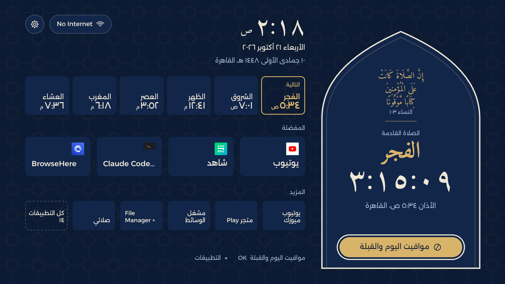
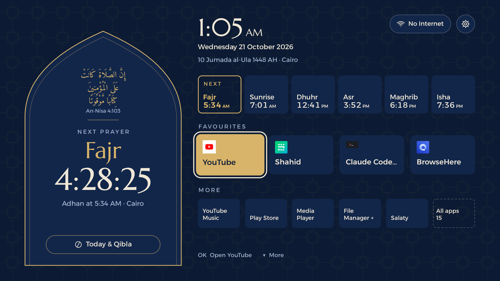
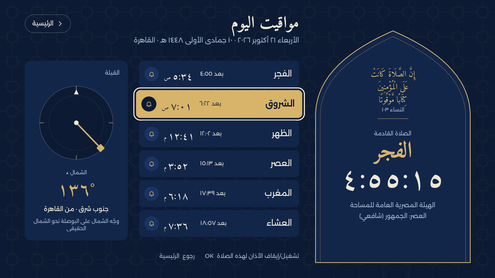
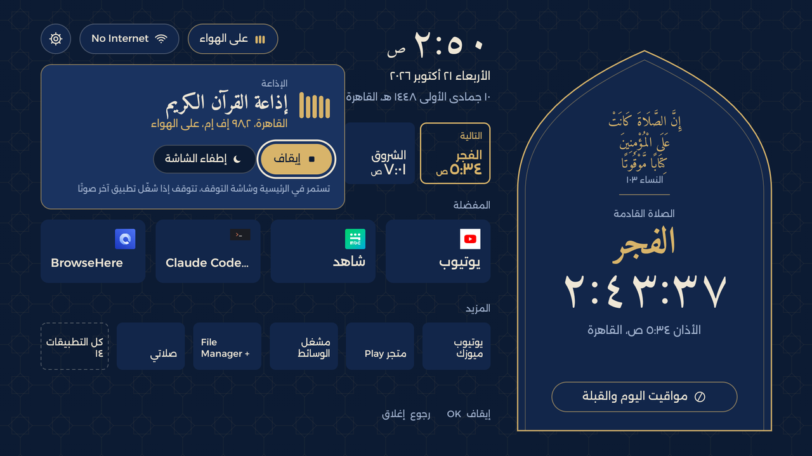
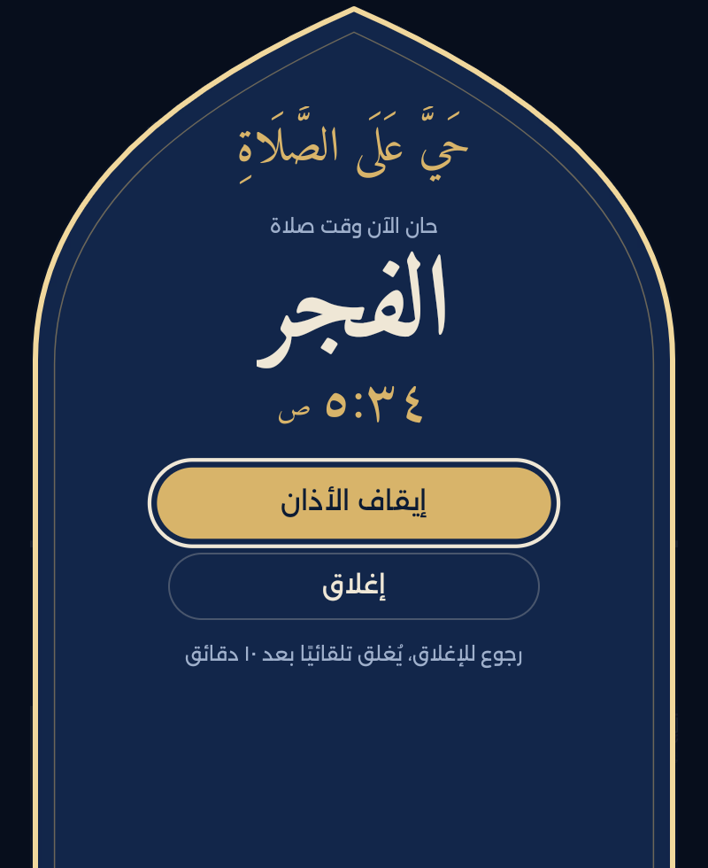
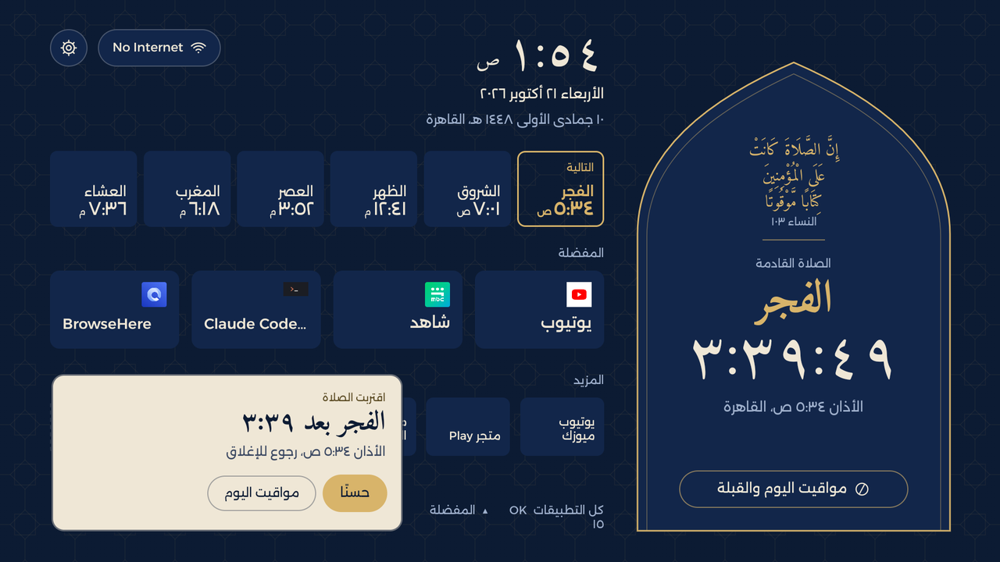
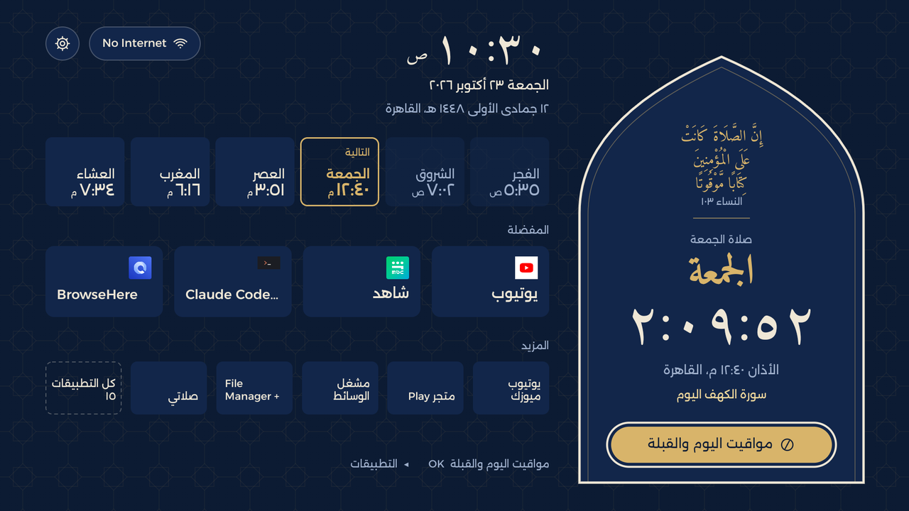
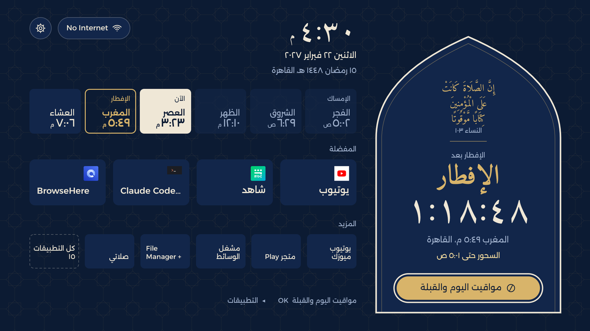
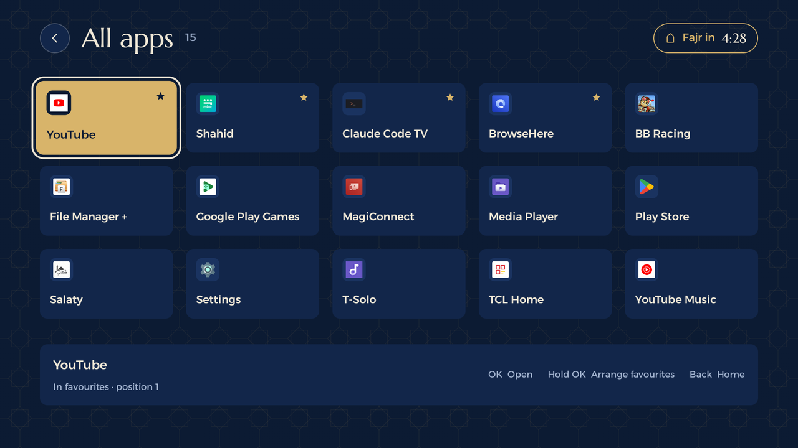
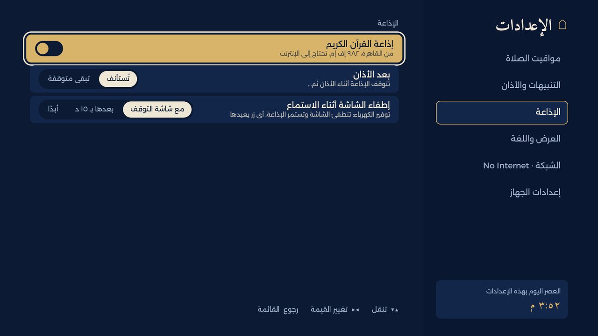

<div align="center">

# Afnon · أفنون

**An Android TV home screen built around the prayer day.**

<p dir="rtl"><b>أفنون: شاشة رئيسية لتلفاز أندرويد، تدور حول يوم الصلاة: المواقيت والقبلة والأذان وإذاعة القرآن الكريم.</b></p>

Arabic first (RTL) and English · Offline prayer times for 136 cities · 14 adhan voices · Qibla · 16 Quran radio stations and reciters

**[⬇ Download the APK](https://github.com/egyjs/afnon-android-tv-launcher/releases/latest/download/afnon.apk)** · [Releases](https://github.com/egyjs/afnon-android-tv-launcher/releases) · **[Try it in your browser](https://egyjs.github.io/afnon-android-tv-launcher/)**



</div>

> إِنَّ الصَّلَاةَ كَانَتْ عَلَى الْمُؤْمِنِينَ كِتَابًا مَّوْقُوتًا · النساء ١٠٣
>
> *Indeed, prayer has been decreed upon the believers at fixed times.* (An-Nisa 4:103)

Afnon replaces the stock launcher on an Android TV with one quiet screen. The next prayer and a live
countdown sit inside a mihrab arch. The day's six times run across the top, your favourite apps sit
below, and the call to prayer comes to the TV by itself. Built and tested on a **TCL 55P7K (Google
TV, Android 12)**, driven only by the remote's D-pad.

### How it started

Afnon started from [cleanyourtv](https://github.com/Gathin23/cleanyourtv):

1. **Debloat.** cleanyourtv's prompt cleared the TCL's ads and bloat, reversibly, with a backup and a restore script.
2. **Launcher.** cleanyourtv's Apple TV-style home took over from the stock one.
3. **Design.** A new direction, *Mihrab*, was designed around the prayer day: lapis and gold, with an arch for the next prayer.
4. **Build.** [Claude Code](https://claude.com/claude-code) built it on the real TV over ADB, one screen at a time, checking each with a screenshot.

<p dir="rtl">بدأ أفنون من مشروع <a href="https://github.com/Gathin23/cleanyourtv">cleanyourtv</a>: تنظيف التلفاز من الإعلانات، ثم شاشة رئيسية بسيطة، ثم تصميم «محراب» حول يوم الصلاة، ثم بناؤه على التلفاز نفسه شاشةً شاشة.</p>

---

## Screens

| | |
|---|---|
|  |  |
| **Home (English).** The clock follows the TV's 12/24-hour setting. Gregorian and Hijri dates, six prayer times with the next one marked, favourites and more apps. | **Today's prayers.** Every time with its countdown, an adhan on/off bell per prayer, and the Qibla bearing from your city. |
|  |  |
| **Quran Radio.** A header pill opens the station card. The bars breathe while it plays. | **The call.** At prayer time the screen comes up over whatever is playing and the adhan plays by itself. |
|  |  |
| **Reminder.** A card a few minutes before the prayer (a banner when another app is open). | **Screensaver.** A dim, drifting arch with the clock and the next prayer, plus the radio when it plays. |
|  |  |
| **Friday.** Jumu'ah replaces Dhuhr, with a Surat al-Kahf reminder. | **Ramadan.** Iftar and suhoor take over the countdown. |
|  |  |
| **All apps.** Every launchable app. Hold OK on one to move it in favourites, uninstall it (apps you installed) or open its details (Android's App info, with its permissions); Home's Favourites and More tiles have the same menu. | **Settings on the TV.** Prayer times, reminders and adhan, radio, display and language. |

## Features

- **Prayer times, fully offline.** Calculated on the TV with
  [adhan-java](https://github.com/batoulapps/adhan-java). It ships with 136 cities in 43 countries across
  the Arab world, Asia, Europe, the Americas, Africa and Oceania, picked by region, then country, then city. Each
  city starts on the method and Asr school its mosques use; you can still choose the calculation method (Egyptian,
  Umm al-Qura, MWL, Karachi and more), the Asr school (Shafi'i or Hanafi) and a Hijri date offset. The Hijri date and Ramadan mode always use the
  Umm al-Qura calendar, so where local moon sighting differs (the United States, for one) set the offset.
- **Qibla and room direction.** The Qibla bearing from your city, and a one-time "which way does
  the TV face" setting, so the screen can say *"Qibla is behind you"*.
- **The adhan.** 14 voices to choose from, plus a separate Fajr adhan. If the TV is muted or at
  zero, the volume comes up for the adhan and goes back afterwards.
- **Reminders.** A card on Home, or a banner over other apps, 5 to 30 minutes before each prayer. It can
  also say «اقترب موعد صلاة …», and when a prayer's adhan is off, «حان الآن موعد صلاة …» as its time begins
  (both lower whatever is playing for a moment instead of pausing it; see `tools/fetch-announce.sh` below).
- **Friday and Ramadan.** Both modes switch themselves on from the date.
- **The weather.** For the city the prayer times use, from [Open-Meteo](https://open-meteo.com/): today's
  temperature, sky, high and low under the dates, and the week ahead beside them under the header pills, a column
  a day with a symbol, the high and the low (today's name in gold). As many days as fit beside the dates, up to
  seven.
- **Quran Radio.** إذاعة القرآن الكريم from Cairo (98.2 FM) by default, streamed live. Settings → Radio
  → Station picks another:
  - Quran radios: Nablus, Shabab FM Quran (Nablus), Qatar 1 and 2, Jordan.
  - Ten reciters' 24/7 channels from mp3quran.net (Alafasy, Abdul Basit, Al-Minshawi, Al-Husary, Al-Muaiqly,
    Al-Ghamdi, Al-Sudais, Al-Dosari, Al-Qatami, Mohammad Rashad Al-Shareef).
  - Level bars that breathe while it plays (Afnon never reads the audio).
  - It pauses for the adhan and resumes after.
  - **Screen off while listening**, using TCL's own Audio Only mode: the panel goes dark and the
    recitation keeps playing.
- **Remote buttons.** An accessibility service maps the remote's app buttons, and its Settings,
  Input and All apps buttons, to Afnon. The stock home's background service can then be disabled.
  On Google TV, where the stock launcher keeps Home for as long as it is enabled, the same service puts
  Afnon over the stock home screen whenever it comes up (`HomeTakeover.java`), so the launcher and the
  setup wizard can stay enabled. Casting needs the wizard: the Cast receiver loads its credentials from it.
- **Arabic and English.** RTL and LTR layouts. Language follows the TV or is set in Afnon. Digits
  are Arabic-Indic or Latin. The **Language** pill in the header switches the whole TV, English first and Arabic
  second (or the other way round), and both homes follow it.
- **Light on the TV.** Plain Java and Views, with no AndroidX, Kotlin or Compose. No blur, no
  video, no shadows. It runs smoothly on a 1.8 GB TV.

## Privacy

Afnon has **no accounts, no analytics and no ads**. Two features use the internet. The radio connects
only to the chosen station's stream, one at a time: `stream.radiojar.com` (Cairo),
`quran-radio.org` (Nablus), `streaming.zaytonatube.com` (Shabab FM), `live.kwikmotion.com` (Qatar),
`jrtv-live.ercdn.net` (Jordan) or `backup.qurango.net` (the reciters). The list is in `Radio.STATIONS`. The
weather asks `api.open-meteo.com` over HTTPS for the current weather and the week's forecast at the chosen city's
coordinates, at most every 30 minutes. Afnon makes no other network requests, and its
[network security config](app/src/main/res/xml/network_security.xml) allows plain HTTP for the Cairo stream only.
Your settings stay on the TV; the weather request carries only the city's coordinates. Afnon never asks for the
microphone (no `RECORD_AUDIO`), so the radio's level bars breathe rather than follow the voice.

The [web preview](https://egyjs.github.io/afnon-android-tv-launcher/) is a separate static site, not the app. It loads
nothing from other sites except the station's stream when you press Play, and keeps your settings in your browser.

| Permission | Why |
|---|---|
| `INTERNET`, `WAKE_LOCK` | The radio stream, kept playing with the screen off |
| `WRITE_SECURE_SETTINGS` | Turns the TV's sleep timer off while the radio plays, and puts it back after. On TCL, also writes the remote button mappings (see TCL notes) |
| `ACCESS_FINE_LOCATION` | Android 9+ hides the Wi-Fi name without it; Home shows the name. Afnon never reads the TV's location |
| `CHANGE_CONFIGURATION`, `WRITE_SETTINGS` (app-op) | The Language pill sets the TV's own language, English or Arabic, as Settings → System → Language does. Both are granted over adb; without them the pill switches Afnon alone |
| `REQUEST_DELETE_PACKAGES` | Uninstall in an app's hold-OK menu opens Android's own confirmation, which Android 9+ shows only to apps that hold it. Afnon never removes an app itself |
| Accessibility service | Remote button mapping (see `RemoteKeys.java`) |

## Install

### Quick: the APK

Download [`afnon.apk`](https://github.com/egyjs/afnon-android-tv-launcher/releases/latest/download/afnon.apk) from the latest release, then:

```bash
export TV=192.168.1.50:5555
adb connect $TV
adb -s $TV install -r afnon.apk
adb -s $TV shell cmd package set-home-activity tv.afnon.home/.MainActivity
adb -s $TV shell settings put secure screensaver_components tv.afnon.home/.AfnonDream
adb -s $TV shell pm grant tv.afnon.home android.permission.WRITE_SECURE_SETTINGS
adb -s $TV shell pm grant tv.afnon.home android.permission.ACCESS_FINE_LOCATION
adb -s $TV shell pm grant tv.afnon.home android.permission.CHANGE_CONFIGURATION
adb -s $TV shell appops set tv.afnon.home WRITE_SETTINGS allow
```

Then turn on **Afnon remote buttons** in the TV's Settings → Accessibility. The APK includes the adhan recordings.
On Google TV that service is also what keeps Home on Afnon: `set-home-activity` prints `Success` there and Home
still opens the stock launcher, which should stay enabled.

### From source

You need a computer with **adb**, **JDK 17**, the Android SDK (platform 34), and the TV with
**Developer options → USB / Network debugging** on.

```bash
git clone https://github.com/egyjs/afnon-android-tv-launcher.git
cd afnon-android-tv-launcher
export TV=192.168.1.50:5555          # your TV's address
adb connect $TV                      # accept the prompt on the TV
bash tools/install.sh                # fetches the adhans, builds, installs, sets Afnon as home
```

`install.sh` runs `tools/fetch-adhans.sh` the first time. That script downloads the 14 recordings
from [abodehq/Athan-MP3](https://github.com/abodehq/Athan-MP3). They aren't in this repo because
that collection has no licence.

The spoken reminder and «حان الآن موعد صلاة …» are 12 short clips made on your machine: `install.sh` runs
`tools/fetch-announce.sh` the first time, which reads `tools/announce-lines.txt` with a Microsoft neural Arabic voice
through [edge-tts](https://github.com/rany2/edge-tts) (`pip install edge-tts`; `VOICE=` picks another) into
`app/src/main/assets/announce/`. They aren't in this repo; the release APK includes them. Without them
those two stay silent and everything else works.

**Close network debugging when you're done.** Port 5555 is plain text, and on some firmware any
device on your network can get a shell through it. Switch USB debugging and Network debugging off
in Developer options, revoke the USB debugging authorisations, reboot, and check that
`nc -vz <tv-ip> 5555` fails.

## Everyday changes

| I want to… | Do this |
|---|---|
| Change favourites | Hold **OK** on an app in All apps or on a More tile on Home → *Put in favourites instead of…*; on a favourite → *Move earlier* or *Move later in favourites* |
| Uninstall an app, or see its permissions | Hold **OK** on it in All apps, or on its Favourites or More tile on Home → *Uninstall* (apps you installed), or *Details* (Android's App info page) |
| Change city, method, adhan voice, radio options | The remote's **Settings** button, or the gear on Home |
| Point a remote button at another app | Edit the table at the top of `RemoteKeys.java`, then `bash tools/install.sh` |
| Change colours or the star pattern | `Tokens.java` (the design tokens) and `Ui.starLattice` |
| Disable a stock app | `bash tools/disable.sh <package>` (reversible; logged to `state/disabled.log`) |
| Re-enable an app | `bash tools/enable.sh <package>`, or on the TV: Settings → Apps → See all apps → Show system apps → the app → Enable |
| Go back to stock | `bash tools/restore.sh`, then reboot. Re-enables everything in the log, restores home, screensaver and sleep timer, and uninstalls Afnon. |

### Trying things without waiting for a prayer

These go to `tv.afnon.home/.Test`, which needs `WRITE_SECURE_SETTINGS`, so only the adb shell can start it. Home
itself ignores them, since any app on the TV can start Home.

```bash
adb shell am start -n tv.afnon.home/.Test --es test friday    # or ramadan, now (back to today)
adb shell am start -n tv.afnon.home/.Test --es test reminder  # Home's reminder card, spoken
adb shell am start -n tv.afnon.home/.Test --es test call      # the call screen, 8 s later
adb shell am start -n tv.afnon.home/.Test --es test banner    # the banner and its voice, 8 s later (open another app)
adb shell am start -n tv.afnon.home/.Test --es test announce  # «حان الآن موعد صلاة …», 8 s later
adb shell am start -n tv.afnon.home/.Test --es test radio     # radio on / off
adb shell am start -n tv.afnon.home/.Test --es station nablus # pick a station (ids in Radio.STATIONS)
bash tools/shot.sh home                                       # screenshot to state/shots/
```

## TCL notes

Some of this is TCL-specific. Each piece fails quietly on other brands:

- **Audio Only** (screen off while listening) asks TCL Settings to show its own countdown dialog
  (`com.tcl.settings.SHOW_WINDOW`, `Type=AudioOnly`). Elsewhere Afnon falls back to a black,
  dimmed screen.
- TCL remotes send Settings as `KEYCODE_NOTIFICATION` and the browser key as code `4159`.
- The remote buttons go through TCL's own button remapping (`TclKeys.java`), so the accessibility
  service doesn't filter keys and holding Volume keeps changing it. Elsewhere the service filters keys itself.
- `install.sh` grants TCL's `APP_AUTO_START` so the remote buttons service survives a reboot.
- Android's `screen_brightness` setting does nothing on this TV, because TCL drives the backlight
  itself.

## Other brands (CVTE)

Tested on one Super General TV (CVTE board, Android 9). CVTE makes the boards in many budget TVs; Afnon
detects them by their hotkey service and each piece is skipped elsewhere:

- The firmware answers the remote's buttons itself (from `/vendor/menu_config_xml/hotkey.xml`), so the remote
  buttons service doesn't filter keys there (`FirmwareKeys.java`) and holding Volume keeps changing it.
- The firmware leaves Source to the app in front, so Home opens CVTE's source menu
  (`com.cvte.tv.globalui`) itself.
- Buttons wired to an app that can't be replaced (ESHARE opens EShare) can be pointed at another app with
  the `redirects` preference, e.g. `com.ecloud.eshare.server=com.droidlogic.miracast`. Empty by default.
- If Afnon guesses wrong about key filtering on some TV, the `key_filter` preference (`on`/`off`) forces it.
- `install.sh` grants location, which Android 9+ needs before Home can show the Wi-Fi name.

## Project layout

```
app/src/main/java/tv/afnon/home/
  MainActivity        Home: clock, prayer row, favourites, radio pill and card, focus map
  PrayerDayActivity   Today's prayers, Qibla dial, room direction
  AllAppsActivity     Every app; hold OK for its menu
  AppMenu             The hold-OK menu in All apps and on Home: move in favourites, uninstall, details
  SettingsActivity    On-TV settings (prayer, reminders, radio, display, network, device)
  NowActivity         The call to prayer
  AfnonDream          Screensaver
  PrayerWatch         Reminders, banner and the call, run inside the accessibility service
  RemoteKeys          Remote button mapping
  HomeTakeover        Home on Afnon where the firmware keeps it on the stock launcher (Google TV)
  TclKeys             The same buttons through TCL's own remapping, so held keys still repeat
  Radio, RadioBars    Quran Radio player and its level bars
  ScreenOffActivity   Screen off while listening (TCL Audio Only, or a black fallback)
  Announce            The spoken reminder and «حان الآن موعد صلاة …»
  PrayerDay, Prefs, Reminders, Adhans, Text, Tokens, Ui …
tools/                install, restore, disable/enable, fetch-adhans, fetch-announce, screenshot
docs/screenshots/     the images above, all from the real TV
```

---

<div dir="rtl">

## بالعربية

**أفنون** شاشة رئيسية لتلفاز أندرويد، تبدأ من يوم الصلاة. الصلاة القادمة والعدّ التنازلي في قلب
محراب، ومواقيت اليوم الستة في الأعلى، وتطبيقاتك المفضلة تحتها. ويأتي الأذان إلى التلفاز وحده في وقته.

- **مواقيت بلا إنترنت**: تُحسب على التلفاز نفسه، مع ١٣٦ مدينة في ٤٣ دولة تُختار بالمنطقة ثم الدولة ثم المدينة، وعدة طرق حساب، والمذهب الشافعي أو الحنفي في
  العصر، وتعديل التاريخ الهجري. التاريخ الهجري ووضع رمضان يعتمدان دائمًا على تقويم أم القرى، فإن اختلفت رؤية الهلال
  المحلية (كما في الولايات المتحدة) فاضبط التعديل.
- **القبلة واتجاه الغرفة**: اتجاه القبلة من مدينتك، وإعداد لمرة واحدة لاتجاه التلفاز، فتقول لك الشاشة
  «القبلة خلفك».
- **الأذان**: ١٤ صوتًا وأذان خاص للفجر. إن كان الصوت مكتومًا يرتفع للأذان ثم يعود كما كان.
- **التنبيهات**: بطاقة على الرئيسية، أو شريط فوق التطبيقات الأخرى، قبل كل صلاة.
- **الجمعة ورمضان**: تتغير الشاشة وحدها؛ الجمعة مكان الظهر مع تذكير بسورة الكهف، والإفطار والسحور في رمضان.
- **إذاعة القرآن الكريم**: من القاهرة (٩٨٫٢ إف إم) افتراضيًا، بث مباشر، وأعمدة تتحرك مع صوت التلاوة نفسه. تتوقف
  للأذان ثم تُستأنف، ويمكن إطفاء الشاشة أثناء الاستماع لتوفير الكهرباء. ومن الإعدادات ← الإذاعة ← المحطة:
  إذاعات القرآن الكريم من نابلس وشباب إف إم وقطر والأردن، أو قناة أحد القرّاء العشرة على مدار الساعة.
- **أزرار الريموت**: أزرار التطبيقات والإعدادات والمدخلات تعمل مع أفنون.
- **العربية أولًا**: من اليمين إلى اليسار، مع الإنجليزية، والأرقام عربية أو لاتينية.
- **بلا حسابات ولا إعلانات ولا تتبّع**. الإذاعة وحدها تستخدم الإنترنت.

للتثبيت حمّل ملف [`afnon.apk`](https://github.com/egyjs/afnon-android-tv-launcher/releases/latest/download/afnon.apk) من صفحة الإصدارات، أو ابنِه من المصدر كما في قسم **Install** أعلاه. وللعودة إلى الشاشة الأصلية شغّل `tools/restore.sh` ثم أعد تشغيل
التلفاز. وبعد الانتهاء أغلق «تصحيح الأخطاء عبر الشبكة» في خيارات المطوّرين.

</div>

---

## Credits

- Prayer times: [adhan-java](https://github.com/batoulapps/adhan-java) (MIT) by Batoul Apps.
- Adhan recordings: [abodehq/Athan-MP3](https://github.com/abodehq/Athan-MP3). They are not in the
  source; `fetch-adhans.sh` downloads them, and the release APK includes them with this credit. If you
  hold the rights to a recording and want it removed, open an issue.
- Radio: إذاعة القرآن الكريم, Cairo; Holy Quran Radio, Nablus; Shabab FM; Qatar's and Jordan's Quran radios;
  and [mp3quran.net](https://mp3quran.net)'s reciter channels, each via its own public stream. Afnon is not
  affiliated with any of them.
- Fonts: [Amiri](https://github.com/aliftype/amiri), [Alexandria](https://fonts.google.com/specimen/Alexandria)
  and [Marcellus](https://fonts.google.com/specimen/Marcellus), all under the SIL Open Font Licence.
  See [THIRD_PARTY.md](THIRD_PARTY.md).
- Started from [cleanyourtv](https://github.com/Gathin23/cleanyourtv). Built with
  [Claude Code](https://claude.com/claude-code) on the real TV, screenshot by screenshot.

Contributions are welcome; see [CONTRIBUTING.md](https://github.com/egyjs/afnon-android-tv-launcher/blob/main/CONTRIBUTING.md). Released under the
[MIT licence](LICENSE).
